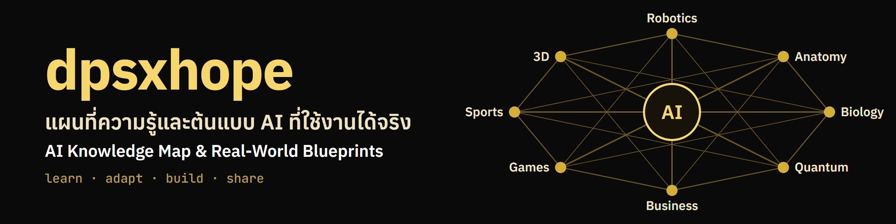

<p align="center">
  
</p>

<p align="center">
  <a href="LICENSE"></a>
  <a href="LICENSE-CONTENT.md"></a>
  
  
  
</p>

<p align="center">
  <a href="#quick-start">Quick start</a> ·
  <a href="#choose-a-blueprint">Choose a blueprint</a> ·
  <a href="#use-your-documents">Use your documents</a> ·
  <a href="ROADMAP.md">Roadmap (Thai)</a> ·
  <a href="README.md">ภาษาไทย</a>
</p>

**dpsxhope** is a Thai-first AI engineering handbook and set of blueprints you can adapt to your own documents, systems, and work.

It starts with RAG, agents, evaluation, and AI APIs. It's growing into a knowledge map that connects AI with robotics, anatomy, biology, quantum computing, business, games, sports, and 3D.

## Quick start

No terminal skills needed: a menu (in Thai) walks you through it. The only requirement is **Python 3.11 or later** ([download](https://www.python.org/downloads/); on Windows tick "Add python.exe to PATH" in the installer).

1. **Download:** click the green Code button on GitHub, choose Download ZIP, and unzip it close to the drive root, for example `C:\dpsxhope` (Windows limits paths to 260 characters and the search libraries nest deeply). Or use `git clone`.
2. **Open the menu:**
   - Windows: double-click `start.cmd`. If Windows asks about security, the file is a short script you can read in Notepad first.
   - macOS, Linux: open a terminal in this folder and run `bash start.sh`.
3. **Press Enter on the step the menu recommends.** It checks your machine and tells you what to do next.

| Item | What it does |
|---|---|
| 1 | First-time setup: installs libraries and lets you choose the AI that writes answers (the first run takes several minutes) |
| 2 | Try it first: a demo on sample documents that never touches your own files. The search part works even without a key |
| 3 | Add my documents: put `.txt`, `.md`, `.pdf` files in the `my-docs` folder, or pick another folder |
| 4 | Ask questions about your documents, with cited sources |
| 5 | Run an agent (uses Claude) |
| 6 | Settings: switch AI, enter an API key, change how many sources are used |
| 7 | Check this machine and see what's missing |
| 8 | Create a new tool for the agent from a template |

Searching your documents always happens on your machine. With **Ollama** the whole thing stays local and has no API fee. With **Claude**, the passages relevant to each question are sent to Anthropic and usage is billed, so don't use confidential or personal documents unless you are allowed to share them.

Prefer a terminal? `python hope.py setup`, `python hope.py demo`, `python hope.py docs`, `python hope.py ask "your question"`, `python hope.py config set RAG_TOP_K 6`, and `python hope.py new-tool check_stock` do the same things. Set an API key with `python hope.py config set ANTHROPIC_API_KEY` and leave the value off: it asks without echoing, so the key doesn't land in your shell history.

## Field maps

AI connected to other fields. Each field has a map, lessons, and a runnable demo (currently in Thai). See [fields/](fields/README.md).

- **Robotics (v0.1):** [map](fields/robotics/README.md) and [lesson 1, from heart to mechanism](fields/robotics/01-heart-to-mechanism.md). It follows one spoken command through five layers down to the motor. Run the demo now, no hardware needed:
  `python fields/robotics/heart-to-mechanism/simulate.py "ไปที่ 1 เมตร"` (or `"move to 1"`)

## Choose a blueprint

| Build | Blueprint | Adapt it by | Requires |
|---|---|---|---|
| **Document Q&A** | [`rag-pipeline`](rag-pipeline/) | Adding `.txt`, `.md`, and `.pdf` files plus your test cases | Ollama or an API key |
| **Internal assistant** | [`agent-kit`](agent-kit/) | Adding tool files and a system prompt | API key |
| **AI quality checks** | [`llm-eval`](llm-eval/) | Using your test cases and CI thresholds | Ollama or an API key |
| **AI service** | [`ai-api`](ai-api/) | Setting auth, CORS, prompts, and deployment | Node.js, API key |

Before you open a system to other people, read the [adoption guide](BLUEPRINTS.md). It's currently in Thai.

## Use your documents

You need Git and Python 3.11 or later.

```bash
git clone https://github.com/shinjangforever/dpsxhope.git
cd dpsxhope
python -m venv .venv
```

Activate the virtual environment:

```bash
# macOS, Linux, Termux
source .venv/bin/activate
```

```powershell
# Windows PowerShell
.\.venv\Scripts\Activate.ps1
```

Install the dependencies and build the index:

```bash
pip install -r rag-pipeline/requirements.txt
cp .env.example .env
cd rag-pipeline
python pipeline.py ingest --docs /path/to/your-docs
```

Choose how to generate answers in `.env`:

| Option | Settings |
|---|---|
| **Local Ollama** | `LLM_PROVIDER=ollama` and `OLLAMA_MODEL=<model name>` |
| **Claude API** | `LLM_PROVIDER=anthropic` and `ANTHROPIC_API_KEY=<key>` |

Then ask a question:

```bash
python pipeline.py query "What is our leave policy?"
```

If you don't have documents yet, try `sample_docs/` first.

## Reference modules

| Module | Use it for | Level |
|---|---|---|
| [`local-models`](local-models/) | Engine control, status checks, and prompt formats | Reference tool |
| [`languages`](languages/) | AI patterns across programming languages | Reference example |
| [`domains`](domains/) | Starting points for robotics, quantum computing, and cloud | Reference example |

## Configure models

Every module reads `.env` from the repo root. You can change model versions without editing code.

```env
CLAUDE_MODEL=claude-haiku-5-5
GEMINI_MODEL=gemini-3.5-flash
OLLAMA_MODEL=llama3.2
```

> [!WARNING]
> Don't commit `.env`, and don't expose `ai-api` to the internet without setting `APP_API_KEY`.

## Check and test

`hope.py` uses only the Python standard library. It needs no API key and no Docker.

```bash
python hope.py status
```

Shows what is installed, whether keys are set, and whether Ollama is running.

```bash
python hope.py list -v
```

Lists each blueprint with what has been tested and what has not (the data lives in [catalog.json](catalog.json)).

```bash
python hope.py check
```

Checks the catalog, links in the docs, and unit tests including Thai search. Run it before opening a pull request.

```bash
python hope.py test mock
```

Tests the agent, workflows, `llm-eval`, and `ai-api` against a mock Anthropic server. Run `npm ci --prefix ai-api` first. It does not judge the quality of real model answers.

## Contributing

You can fix broken commands, add blueprints, or propose a new field. See [CONTRIBUTING.md](CONTRIBUTING.md) and [ROADMAP.md](ROADMAP.md). Those guides are currently in Thai.

## License

Code uses the [MIT License](LICENSE). Content uses [CC BY 4.0](LICENSE-CONTENT.md). Third-party files keep their original licenses.

## Author

**Daranpat Pattarakanpong (Shin)**
