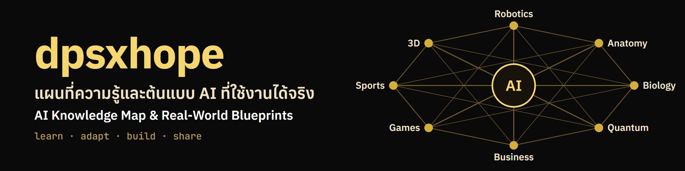

<p align="center">
  
</p>

<p align="center">
  <a href="LICENSE"></a>
  <a href="LICENSE-CONTENT.md"></a>
  
  
  
</p>

<p align="center">
  <a href="#เริ่มใน-5-นาที">เริ่มใน 5 นาที</a> ·
  <a href="#เลือกต้นแบบ">เลือกต้นแบบ</a> ·
  <a href="BLUEPRINTS.md">นำไปใช้จริง</a> ·
  <a href="ROADMAP.md">Roadmap</a> ·
  <a href="README.en.md">English</a>
</p>

**dpsxhope** คือคู่มือและชุดต้นแบบ AI engineering ภาษาไทย สำหรับนำไปปรับใช้กับเอกสาร ระบบ และงานจริงของคุณ

เนื้อหาเริ่มจาก RAG, agent, การประเมินผล และ AI API แล้วจะขยายเป็นแผนที่ความรู้ที่เชื่อม AI กับ robotics, anatomy, biology, quantum, business, games, sports และ 3D

## เริ่มใน 5 นาที

ไม่ต้องรู้จักคำสั่ง terminal ใช้เมนูภาษาไทยแทน สิ่งที่ต้องมีอย่างเดียวคือ **Python 3.11 ขึ้นไป** ([ดาวน์โหลด](https://www.python.org/downloads/) บน Windows ให้ติ๊ก "Add python.exe to PATH" ตอนติดตั้ง)

1. **ดาวน์โหลด:** กดปุ่ม Code สีเขียวบนหน้า GitHub แล้วเลือก Download ZIP จากนั้นแตกไฟล์ไว้ใกล้ราก เช่น `C:\dpsxhope` (Windows จำกัดความยาวพาธที่ 260 ตัวอักษร และไลบรารีค้นหามีไฟล์ซ้อนลึก ถ้าวางไว้ลึกเกินไปการติดตั้งอาจล้มเหลว) หรือใช้ `git clone`
2. **เปิดเมนู:**
   - Windows: ดับเบิลคลิก `start.cmd` ถ้า Windows ถามเรื่องความปลอดภัย ไฟล์นี้เป็นสคริปต์สั้นๆ เปิดอ่านด้วย Notepad ก่อนได้
   - macOS, Linux: เปิด terminal ในโฟลเดอร์นี้แล้วพิมพ์ `bash start.sh`
3. **กด Enter ตามที่เมนูแนะนำ:** เมนูดูสถานะเครื่องและบอกเองว่าขั้นต่อไปคืออะไร

| ข้อ | ทำอะไร |
|---|---|
| 1 | ตั้งค่าครั้งแรก: ติดตั้งไลบรารี และเลือก AI ที่ใช้ตอบ (ครั้งแรกใช้เวลาหลายนาที เพราะไลบรารีค้นหามีขนาดใหญ่) |
| 2 | ลองดูก่อน: เดโมด้วยเอกสารตัวอย่าง ไม่แตะเอกสารของคุณ และเห็นส่วนค้นหาได้แม้ยังไม่มี key |
| 3 | ใส่เอกสารของฉัน: วางไฟล์ `.txt` `.md` `.pdf` ในโฟลเดอร์ `my-docs` หรือเลือกโฟลเดอร์อื่น |
| 4 | ถามคำถามจากเอกสาร: คำตอบมีแหล่งอ้างอิง ถามต่อเนื่องได้ |
| 5 | ให้ agent ทำงาน (Claude หรือ Ollama ในเครื่อง) |
| 6 | ตั้งค่า: เปลี่ยน AI, ใส่ API key, ปรับจำนวนแหล่งอ้างอิง |
| 7 | ตรวจเครื่อง: บอกว่าขาดอะไร พร้อมวิธีแก้ |
| 8 | สร้างเครื่องมือใหม่ให้ agent จากแม่แบบ |
| 9 | งานอัตโนมัติ: วางไฟล์ในโฟลเดอร์ แล้วให้ดึงงานที่ต้องทำหรือสรุปให้ ดูก่อนได้ว่าจะทำอะไร |

ถ้ากำลังอยู่ใน terminal บน Windows ให้พิมพ์ `.\start.cmd` (มี `.\` นำหน้า)

### ใช้ AI ตัวไหนตอบ

การค้นหาเอกสารทำในเครื่องของคุณทั้งสองแบบ ต่างกันที่ขั้นสร้างคำตอบ

| | Ollama (ในเครื่อง) | Claude API |
|---|---|---|
| ค่าใช้จ่าย | ไม่มีค่า API ใช้เครื่องและไฟฟ้าของคุณ | คิดตามการใช้งาน |
| ข้อมูล | ไม่ออกจากเครื่อง | ช่วงเอกสารที่เกี่ยวข้องกับคำถามถูกส่งไปยัง Anthropic |
| ต้องมี | ติดตั้ง Ollama กับโมเดล และเครื่องที่แรงพอ | API key |
| ใช้กับ | ถามตอบจากเอกสาร, `llm-eval` | ทุกต้นแบบ รวมถึง agent |

เอกสารลับหรือข้อมูลส่วนบุคคลที่ไม่ได้รับอนุญาตให้ส่งออก ควรใช้ Ollama

### ใช้ทำอะไรได้ในที่ทำงาน

| สถานการณ์ | เริ่มจาก | ข้อควรระวัง |
|---|---|---|
| ถามตอบคู่มือพนักงานและนโยบาย HR | ใส่ไฟล์นโยบายใน `my-docs` แล้วถามจากข้อ 4 | เอกสารเปลี่ยนแล้วต้องใส่ใหม่ และตรวจคำตอบกับต้นฉบับเสมอ ชุดทดสอบภาษาไทยของโปรเจกต์มีขนาดเล็ก |
| ฐานความรู้ให้ทีมซัพพอร์ต (เงื่อนไขคืนสินค้า รับประกัน FAQ) | `rag-pipeline` | ถ้าจะให้ลูกค้าถามเอง ต้องต่อระบบเองตาม [คู่มือนำไปใช้จริง](BLUEPRINTS.md) เพราะ `ai-api` ยังไม่ได้ต่อกับ RAG |
| ค้นเอกสารยาว เช่น สัญญา ข้อเสนอ รายงาน บันทึกประชุม | `rag-pipeline` | PDF แบบสแกนอ่านไม่ได้ และคำตอบไม่ใช่คำปรึกษากฎหมายหรือการเงิน |
| ผู้ช่วยทำงานซ้ำ เช่น เช็กสต็อก ดึงข้อมูลลูกค้า | ข้อ 8 สร้าง tool แล้วให้ agent ใช้ | ตั้ง `REQUIRES_APPROVAL = True` ให้ tool ที่แก้ข้อมูล ส่งข้อความ หรือจ่ายเงิน |
| ตรวจคุณภาพ AI ก่อนปล่อยใช้ | `llm-eval` พร้อมเกณฑ์ขั้นต่ำใน CI | คะแนนมาจาก LLM ที่ทำหน้าที่ตัดสิน ควรสุ่มตรวจด้วยคนด้วย |

## แผนที่สาขา

AI ที่เชื่อมกับสาขาอื่น แต่ละสาขามีแผนที่ บทเรียน และเดโมที่รันได้ ดู [fields/](fields/README.md)

- **หุ่นยนต์ (v0.2):** [แผนที่](fields/robotics/README.md) และ [บทที่ 1 จากหัวใจสู่กลไก](fields/robotics/01-heart-to-mechanism.md) ตามคำสั่งหนึ่งประโยคผ่านห้าชั้นจนถึงมอเตอร์ รันเดโมได้ทันทีโดยไม่ต้องมีฮาร์ดแวร์:
  `python fields/robotics/heart-to-mechanism/simulate.py "ไปที่ 1 เมตร"`
  มีหุ่นยนต์ของตัวเอง ใช้ [robokit](fields/robotics/robokit/README.md): วางแผนโปรเจกต์ ด่านตรวจคำสั่งจาก AI จูน PID และตรวจระยะหยุด เริ่มที่ `python hope.py robot plan`

## เลือกต้นแบบ

| ต้องการสร้าง | ต้นแบบ | ปรับใช้โดย | ต้องใช้ |
|---|---|---|---|
| **ถามตอบจากเอกสาร** | [`rag-pipeline`](rag-pipeline/) | ใส่โฟลเดอร์ `.txt`, `.md`, `.pdf` และชุดทดสอบของคุณ | Ollama หรือ API key |
| **ผู้ช่วยเรียกระบบภายใน** | [`agent-kit`](agent-kit/) | เพิ่มไฟล์ tool และ system prompt | Ollama หรือ API key |
| **งานที่เกิดเองเมื่อมีไฟล์เข้า** | [งานอัตโนมัติ](agent-kit/README.md#งานอัตโนมัติ) | คัดลอกไฟล์งานตัวอย่างแล้วแก้ขั้น | Python (ขั้นถาม AI ใช้ Ollama หรือ API key) |
| **ตรวจคุณภาพ AI** | [`llm-eval`](llm-eval/) | ใช้ชุดทดสอบของคุณและตั้งเกณฑ์ใน CI | Ollama หรือ API key |
| **บริการ API** | [`ai-api`](ai-api/) | ตั้ง auth, CORS, prompt และ deploy | Node.js, API key |

ไม่แน่ใจว่าเครื่องของคุณทำอะไรได้แล้ว รัน `python hope.py stack` และดู [แผนที่ stack](stack/README.md) ซึ่งจัดภาษาและเครื่องมือเป็นกลุ่ม แยกเป็นสาย (AI agent, งานอัตโนมัติ, Full stack, Cybersecurity, คณิตศาสตร์, ปรัชญา และอื่นๆ) กับระดับ 1 ถึง 4 พร้อมคำอธิบายของ[เครื่องมือทุกชิ้น](stack/TOOLS.md)และ[ความรู้ของแต่ละระดับ](stack/PATHS.md)

ก่อนเปิดให้ผู้อื่นใช้ อ่าน [คู่มือนำไปใช้จริง](BLUEPRINTS.md) ซึ่งมีจุดที่ต้องเปลี่ยน รายการตรวจ และแนวทางขยายระบบ

## ใช้ผ่าน terminal

ถ้าถนัด terminal จะข้ามเมนูก็ได้ คำสั่งที่ใช้บ่อย:

```bash
python hope.py setup --profile rag --engine ollama -y
python hope.py docs ./my-docs
python hope.py ask "นโยบายลาพักร้อนคืออะไร"
python hope.py config set RAG_TOP_K 6
python hope.py new-tool check_stock
python hope.py auto run inbox-todo --dry-run
python hope.py stack
```

ใส่ API key ด้วย `python hope.py config set ANTHROPIC_API_KEY` โดยไม่ต้องพิมพ์ค่าต่อท้าย ระบบจะถามแบบไม่แสดงตัวอักษร key จึงไม่ค้างในประวัติคำสั่ง ดูรายการค่าทั้งหมดด้วย `python hope.py config --all`

### ติดตั้งเองทีละขั้น

ต้องมี Git และ Python 3.11 ขึ้นไป

```bash
git clone https://github.com/shinjangforever/dpsxhope.git
cd dpsxhope
python -m venv .venv
```

เปิดใช้งาน virtual environment:

```bash
# macOS, Linux, Termux
source .venv/bin/activate
```

```powershell
# Windows PowerShell
.\.venv\Scripts\Activate.ps1
```

ติดตั้งและสร้าง index:

```bash
pip install -r rag-pipeline/requirements.txt
cp .env.example .env
cd rag-pipeline
python pipeline.py ingest --docs /path/to/your-docs
```

เลือกวิธีสร้างคำตอบในไฟล์ `.env`:

| วิธี | ตั้งค่า |
|---|---|
| **Ollama ในเครื่อง** | `LLM_PROVIDER=ollama` และ `OLLAMA_MODEL=<ชื่อโมเดล>` |
| **Claude API** | `LLM_PROVIDER=anthropic` และ `ANTHROPIC_API_KEY=<key>` |

จากนั้นถามคำถาม:

```bash
python pipeline.py query "นโยบายลาพักร้อนคืออะไร"
```

ถ้ายังไม่มีเอกสาร ใช้ `sample_docs/` เพื่อทดลองก่อนได้

## โมดูลอ้างอิง

| โมดูล | ใช้ทำอะไร | ระดับ |
|---|---|---|
| [`local-models`](local-models/) | ควบคุม LLM engine, ตรวจสถานะ และจัด prompt format | เครื่องมืออ้างอิง |
| [`languages`](languages/) | รูปแบบ AI ในหลายภาษาโปรแกรม | ตัวอย่างอ้างอิง |
| [`domains`](domains/) | จุดเริ่มต้นสำหรับ robotics, quantum และ cloud | ตัวอย่างอ้างอิง |

## ตั้งค่าโมเดล

ทุกโมดูลอ่านไฟล์ `.env` ที่ root ของ repo เปลี่ยนรุ่นโมเดลได้โดยไม่ต้องแก้โค้ด

```env
CLAUDE_MODEL=claude-haiku-5-5
GEMINI_MODEL=gemini-3.5-flash
OLLAMA_MODEL=llama3.2
```

> [!WARNING]
> อย่า commit ไฟล์ `.env` และอย่าเปิด `ai-api` ออกอินเทอร์เน็ตโดยไม่ตั้ง `APP_API_KEY`

## ตรวจและทดสอบ

`hope.py` ใช้ไลบรารีมาตรฐานของ Python อย่างเดียว ไม่ต้องใช้ API key และไม่ต้องมี Docker

```bash
python hope.py status
```

ดูว่าเครื่องนี้ติดตั้งอะไรแล้ว ตั้ง key แล้วหรือยัง และ Ollama ทำงานอยู่ไหม

```bash
python hope.py list -v
```

ดูต้นแบบแต่ละชิ้น พร้อมสิ่งที่ทดสอบแล้วและสิ่งที่ยังไม่ได้ทดสอบ (ข้อมูลอยู่ใน [catalog.json](catalog.json))

```bash
python hope.py check
```

ตรวจ catalog ลิงก์ในเอกสาร และ unit test รวมถึงการค้นหาภาษาไทย ใช้ก่อนส่ง Pull Request

```bash
python hope.py test mock
```

ทดสอบ agent, workflow, `llm-eval` และ `ai-api` กับเซิร์ฟเวอร์จำลอง Anthropic ต้องรัน `npm ci --prefix ai-api` ก่อน ชุดนี้ไม่ตรวจคุณภาพคำตอบของโมเดลจริง

## หลักการ

- **เริ่มจากงานจริง:** ใช้ข้อมูล กติกา และชุดทดสอบของคุณแทนข้อมูลตัวอย่าง
- **บอกข้อจำกัด:** ทุกต้นแบบระบุสิ่งที่ยังต้องเพิ่มก่อนใช้จริง
- **เปลี่ยนได้:** ไม่ผูกกับผู้ให้บริการโมเดลเจ้าเดียว
- **นำไปต่อได้:** โค้ดและเนื้อหามี license ชัดเจน

## ร่วมพัฒนา

แก้คำสั่งที่พัง เพิ่มต้นแบบ หรือเสนอสาขาใหม่ได้ อ่านแนวทางใน [CONTRIBUTING.md](CONTRIBUTING.md) และดูทิศทางใน [ROADMAP.md](ROADMAP.md)

## License

โค้ดใช้ [MIT](LICENSE) และเนื้อหาใช้ [CC BY 4.0](LICENSE-CONTENT.md) ส่วนไฟล์จากบุคคลที่สามใช้ license ของเจ้าของเดิม

## ผู้สร้าง

**Daranpat Pattarakanpong (Shin)**
