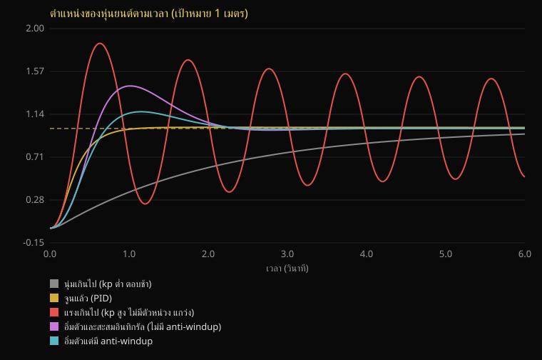

# บทที่ 1 จากหัวใจสู่กลไก

> หุ่นยนต์ไม่ได้ฉลาดเพราะ AI อย่างเดียว ความฉลาดต้องเดินทางผ่านอีกหลายชั้นกว่าจะกลายเป็นแรงที่ขยับของจริง
> บทนี้ตามคำสั่งหนึ่งประโยคไปตลอดทาง ทุกตัวเลขในบทมาจากเดโมที่รันได้ในเครื่องคุณ

**อ่านราว 12 นาที** · **ลองเองได้โดยไม่ต้องมีฮาร์ดแวร์ ไม่ต้องมี API key** · **ข้อจำกัด:** เป็นแบบจำลองของเล่น อ่านหัวข้อ [ข้อจำกัด](#ข้อจำกัด) ก่อนเอาตัวเลขไปอ้าง

สาขานี้ต่อกับ [แผนที่หุ่นยนต์](README.md) ถ้ายังไม่เคยอ่านแผนที่ บทนี้อ่านเดี่ยวๆ ได้

## คำสั่งเดียว ห้าชั้นระหว่างทาง

สมมติสั่งหุ่นยนต์ว่า "ไปที่ 1 เมตร" อะไรเกิดขึ้นตั้งแต่ประโยคนั้นจนถึงล้อที่หมุน

```text
คำสั่ง "ไปที่ 1 เมตร"
  │
  ▼  หัวใจ              ตัดสินใจว่าจะทำอะไร (AI) ผลลัพธ์คือข้อเสนอ ไม่ใช่คำสั่งขาด
  ▼  ด่านความปลอดภัย     กฎตายตัวที่ไม่พึ่งความมั่นใจของ AI ไม่ผ่านคือไม่ไปต่อ
  ▼  ตัวควบคุม           คำนวณแรงที่ต้องใช้ ทุกมิลลิวินาที (ในเดโมนี้คือ PID)
  ▼  ตัวขับเคลื่อน        มอเตอร์ให้แรงได้จำกัด และไม่ให้ทันที
  ▼  กลไก               มวล แรงเสียดทาน กฎของนิวตัน ไม่สนใจเจตนาของใคร
  │
  ▲  วัดตำแหน่งจริงส่งกลับไปที่ตัวควบคุม (feedback) วนไปเรื่อยๆ
```

โดยทั่วไปส่วนบนคิดช้าแต่ฉลาด ส่วนล่างคิดเร็วแต่ไม่ฉลาดเลย ความยากของหุ่นยนต์อยู่ที่รอยต่อระหว่างสองโลกนี้

รันเดโมเพื่อดูครบทุกชั้น:

```bash
python fields/robotics/heart-to-mechanism/simulate.py "ไปที่ 1 เมตร"
```

ผลจริง:

```text
[หัวใจ]            คำสั่ง: 'ไปที่ 1 เมตร'
[หัวใจ -> JSON]    {"action": "move_to", "target_m": 1.0}
[ด่านความปลอดภัย]  ผ่าน (พื้นที่ ±2 m)
[ตัวควบคุม]        PID kp=40 ki=2 kd=12 anti-windup=เปิด
[ตัวขับเคลื่อน]    แรงสูงสุด 20 N หน่วงมอเตอร์ 20 ms
[กลไก]             มวล 1 kg เสียดทาน 0.8 N·s/m
  เกินเป้าสูงสุด 1.19 % | เวลาขึ้น (10-90%) 0.52 s | นิ่งภายใน ±2% ที่ 0.90 s | คลาดเคลื่อนสุดท้าย 9.9 mm | แรงสูงสุด 19.8 N
```

## ชั้นที่ 1 หัวใจ: ผลลัพธ์ของ AI คือข้อเสนอ

ในเดโม "หัวใจ" เป็นตัวอ่านคำสั่งแบบกฎง่ายๆ เพื่อให้ผลซ้ำได้ทุกครั้ง ในงานจริงส่วนนี้คือโมเดลภาษาหรือโมเดลที่รับภาพและภาษาแล้วสั่งการเคลื่อนไหว (VLA) เช่น
[RT-2](https://arxiv.org/abs/2307.15818), [OpenVLA](https://arxiv.org/abs/2406.09246), [π0](https://arxiv.org/abs/2410.24164),
[Gemini Robotics](https://arxiv.org/abs/2503.20020) และ [GR00T N1](https://arxiv.org/abs/2503.14734)
สิ่งที่ทุกตัวส่งต่อให้ชั้นล่างมีรูปร่างเดียวกัน: ข้อมูลที่มีโครงสร้าง ในเดโมคือ JSON หนึ่งก้อน

ข้อคิดข้อแรก: **อย่าปฏิบัติต่อคำตอบของ AI เป็นคำสั่งขาด** ปฏิบัติต่อมันเป็นข้อเสนอที่ชั้นถัดไปมีสิทธิ์ปฏิเสธ

## ชั้นที่ 2 ด่านความปลอดภัย: กฎตายตัว ไม่ใช่ความมั่นใจ

ลองสั่งให้ไปไกลเกินราว (ราวในเดโมเดินได้ ±2 เมตร):

```bash
python fields/robotics/heart-to-mechanism/simulate.py "ไปที่ 5 เมตร"
```

```text
ปฏิเสธ: เป้าหมาย 5.0 m อยู่นอกพื้นที่ที่อนุญาต ±2.0 m
```

โปรแกรมจบด้วย exit code 2 และชั้นตัวควบคุมไม่ถูกเรียกเลย ด่านนี้ทำสามอย่างที่ควรเป็นนิสัย

1. **ปฏิเสธ ไม่ใช่ปรับค่าให้เงียบๆ** ถ้าแก้ 5 เมตรเป็น 2 เมตรโดยไม่บอก ผู้ใช้จะเชื่อว่าหุ่นยนต์ทำตามที่สั่ง
2. **ตรวจรูปแบบอย่างเข้ม** ค่าที่เป็น NaN, infinity, ข้อความ, ฟิลด์แปลกปลอม หรือ action ที่ไม่อยู่ในรายการ ถูกปฏิเสธทั้งคำสั่ง
3. **ไม่พึ่งความมั่นใจที่โมเดลรายงานเอง** กฎเป็นตัวเลขตายตัวที่ AI แก้ไม่ได้

ทำไมต้องเข้มขนาดนี้: งานวิจัยของ Robey และคณะ (2024) รายงานว่าหุ่นยนต์ที่ควบคุมด้วย LLM ถูกหลอกให้ทำสิ่งอันตรายได้
บนระบบที่ทดสอบสามแบบ ทั้งรถขับเคลื่อนอัตโนมัติจำลอง หุ่นยนต์ล้อ และหุ่นยนต์สี่ขา ดู [Jailbreaking LLM-Controlled Robots](https://arxiv.org/abs/2410.13691)
(ผมอ่านจากชื่อเรื่องและบทคัดย่อที่ผู้เขียนเผยแพร่ ยังไม่ได้ตรวจวิธีทดลองทั้งฉบับ)

> **ระวังกับตัวอย่างอื่นใน repo นี้:** [`domains/robotics/ros2_llm_bridge.py`](../../domains/robotics/ros2_llm_bridge.py)
> กรองคำสั่งด้วยค่า `confidence` ที่โมเดลรายงานเองเท่านั้น ไม่มีการตรวจช่วงของ `speed` หรือพิกัด และ `json.loads` ไม่มีการดักข้อผิดพลาด
> จึงยังไม่ควรต่อกับฮาร์ดแวร์ตามที่เป็นอยู่ (ตอนนี้ทดสอบแค่ว่าคอมไพล์ผ่าน) ด่านในเดโมนี้คือแนวทางที่ควรเอาไปเติม

## ชั้นที่ 3 ตัวควบคุม: PID คือความเข้าใจเรื่อง "ตอนนี้ห่างเป้าแค่ไหน"

ตัวควบคุมไม่รู้ว่า AI ต้องการอะไร รู้แค่ว่า ณ ตอนนี้ตำแหน่งคลาดจากเป้าเท่าไร แล้วคำนวณแรงทุกมิลลิวินาที PID มีสามส่วน

| ส่วน | ทำอะไร | ถ้าขาด |
|---|---|---|
| **P** (kp) | ยิ่งห่างยิ่งออกแรงมาก | ไม่มีแรงดึงเข้าหาเป้า |
| **D** (kd) | ต้านความเร็ว เหมือนตัวหน่วง | แกว่งเกินเป้าและไม่นิ่ง |
| **I** (ki) | สะสมความคลาดเคลื่อนที่ค้าง เพื่อดันให้ถึงเป้าจริง | คลาดค้างเมื่อมีแรงต้านคงที่ (ในแบบจำลองนี้แรงเสียดทานเป็นแบบหนืด จึงจำเป็นน้อย) |

ห้าสถานการณ์เดียวกัน คำสั่งเดียวกัน (ไปที่ 1 เมตร) ต่างกันแค่ตัวควบคุมและมอเตอร์:



| สถานการณ์ | เกินเป้าสูงสุด | เวลาขึ้น 10-90% | นิ่งภายใน ±2% |
|---|---|---|---|
| นุ่มเกินไป (kp ต่ำ) | 0.00 % | 4.51 s | ไม่นิ่งใน 6 s |
| **จูนแล้ว** | **1.19 %** | **0.52 s** | **0.90 s** |
| แรงเกินไป (kp สูง ไม่มีตัวหน่วง) | 85.48 % | 0.21 s | ไม่นิ่งใน 6 s |
| มอเตอร์อิ่มตัว ไม่มี anti-windup | 42.72 % | 0.36 s | 2.19 s |
| มอเตอร์อิ่มตัว มี anti-windup | 16.82 % | 0.45 s | 2.17 s |

สร้างตารางนี้ซ้ำได้ด้วย `python fields/robotics/heart-to-mechanism/simulate.py --compare --svg compare.svg`

ข้อคิดข้อสอง: **ยิ่งแรงไม่ได้ยิ่งดี** แถวที่สามเร็วที่สุด (0.21 s) แต่พุ่งเกินเป้าเกือบสองเท่าและแกว่งไม่หยุด
ในโลกจริงการแกว่งแบบนี้คือชนกำแพง หรือชนคน

## ชั้นที่ 4 ตัวขับเคลื่อน: ตัวควบคุมสั่งได้ แต่มอเตอร์ให้ไม่ได้

ตอนเริ่มเคลื่อนที่ ตัวควบคุมเห็นว่าห่าง 1 เมตร และคำนวณแรงราว 40 นิวตัน (kp 40 คูณ 1 เมตร)
แต่มอเตอร์ในเดโมให้ได้สูงสุด 20 นิวตัน ผลคือแรงที่ออกจริงชนเพดาน (แรงสูงสุดที่วัดได้ 19.8 N) และตัวเลขในหัวของตัวควบคุมไม่ตรงกับความจริงอีกต่อไป

นี่คือที่มาของ **integral windup**: ระหว่างที่มอเตอร์อิ่มตัว ส่วน I ยังสะสมความคลาดเคลื่อนต่อไปเรื่อยๆ ทั้งที่เพิ่มแรงไม่ได้
พอใกล้ถึงเป้า ค่าที่สะสมไว้มากเกินยังดันต่อ ทำให้พุ่งเลยเป้า แถวที่สี่ในตารางคือผลนั้น (42.72 %)
วิธีแก้ที่ง่ายที่สุดคือหยุดสะสมเมื่ออิ่มตัว (anti-windup) แถวที่ห้าลดเหลือ 16.82 % ด้วยการเพิ่มเงื่อนไขเดียวในตัวควบคุม

ข้อคิดข้อสาม: **ฉลาดแค่ไหนก็ผ่านขีดจำกัดของกลไกไปไม่ได้** และตัวควบคุมที่ไม่รู้ขีดจำกัดนั้นจะทำร้ายตัวเอง

## ชั้นที่ 5 กลไก: ฟิสิกส์ไม่สนใจเจตนา

ที่ปลายทางคือมวลก้อนหนึ่งบนราง (1 กิโลกรัม แรงเสียดทาน 0.8 N·s/m) ตามสมการ แรงลัพธ์ = มวล × ความเร่ง
ไม่มีส่วนไหนของมันรู้ว่าคำสั่งมาจาก AI หรือมาจากคน มันตอบสนองต่อแรงเท่านั้น
แล้วตำแหน่งที่วัดได้ก็วนกลับไปให้ตัวควบคุมคำนวณรอบต่อไป นี่คือ feedback loop ที่ทำให้หุ่นยนต์ "แก้ตัวเอง" ได้

## ลองเอง

เปลี่ยนค่าแล้วดูว่าทำไมผลถึงเปลี่ยน ทุกคำสั่งต่อไปนี้รันได้ทันที

```bash
python fields/robotics/heart-to-mechanism/simulate.py "ไปที่ 1 เมตร" --kp 200 --kd 1
python fields/robotics/heart-to-mechanism/simulate.py "ไปที่ 2 เมตร" --max-force 5
python fields/robotics/heart-to-mechanism/simulate.py "ไปที่ 1 เมตร" --ki 60 --max-force 8 --no-anti-windup
python fields/robotics/heart-to-mechanism/simulate.py "เดินหน้า 1 เมตร"
python fields/robotics/heart-to-mechanism/simulate.py "ไปที่ 3 เมตร" --workspace 3
```

คำถามชวนคิด

1. ถ้าจะให้ถึงเป้าเร็วขึ้นโดยไม่เกินเป้า ควรเพิ่มค่าไหนบ้าง และมีเพดานจากอะไร
2. ถ้ามอเตอร์แรงเป็นสองเท่า ควรเพิ่ม kp เป็นสองเท่าไหม ทำไม (ลองวัดจริง ไม่ต้องเดา)
3. ด่านความปลอดภัยควรอยู่ก่อนหรือหลังตัวควบคุม และถ้าอยู่หลัง มันต้องตรวจอะไรเพิ่ม

## ข้อจำกัด

- เป็นระบบแกนเดียว มวลเดียว แรงเสียดทานเชิงเส้น มอเตอร์หน่วงลำดับหนึ่ง ไม่มีเซนเซอร์ที่มีสัญญาณรบกวน ไม่มีความหน่วงของการสื่อสาร ไม่มีการสึกหรอ
- ค่าพารามิเตอร์ (มวล แรงเสียดทาน แรงสูงสุด) ตั้งขึ้นเพื่อการสอน ไม่ได้วัดจากหุ่นยนต์ตัวไหน **ตัวเลขในบทนี้ใช้ได้กับแบบจำลองนี้เท่านั้น** อย่านำไปตั้งค่าหุ่นยนต์จริง
- ส่วน "หัวใจ" ในเดโมเป็นกฎ ไม่ได้ทดสอบกับ LLM หรือ VLA จริง
- ด่านความปลอดภัยในเดโมเป็นตัวอย่างหลักการ ไม่ใช่ระบบความปลอดภัยที่ผ่านมาตรฐาน หุ่นยนต์จริงต้องมีปุ่มหยุดฉุกเฉินที่ทำงานเป็นอิสระจากซอฟต์แวร์และการประเมินความเสี่ยงตามมาตรฐาน (ดู [แผนที่](README.md#ความปลอดภัยและจริยธรรม))
- บทนี้ไม่ใช่คำแนะนำทางวิศวกรรมความปลอดภัยหรือกฎหมาย

## ต่อไป

- [แผนที่หุ่นยนต์](README.md): เส้นทางเรียน เครื่องมือ และแหล่งอ้างอิงที่ตรวจแล้ว
- [เดโมและวิธีปรับ](heart-to-mechanism/README.md)
- ขั้นถัดไปที่เหมาะ: เปลี่ยนเป็นแขนกล 2 ข้อต่อใน simulator เช่น MuJoCo (ยังไม่มีในโปรเจกต์นี้)

## แหล่งอ้างอิง (ตรวจเมื่อ 2026-11-10)

- Brohan et al., [RT-2: Vision-Language-Action Models Transfer Web Knowledge to Robotic Control](https://arxiv.org/abs/2307.15818)
- Kim et al., [OpenVLA: An Open-Source Vision-Language-Action Model](https://arxiv.org/abs/2406.09246)
- Black et al., [π0: A Vision-Language-Action Flow Model for General Robot Control](https://arxiv.org/abs/2410.24164)
- Gemini Robotics Team, [Gemini Robotics: Bringing AI into the Physical World](https://arxiv.org/abs/2503.20020)
- NVIDIA, [GR00T N1: An Open Foundation Model for Generalist Humanoid Robots](https://arxiv.org/abs/2503.14734)
- Robey et al., [Jailbreaking LLM-Controlled Robots](https://arxiv.org/abs/2410.13691)

ชื่อเรื่องและผู้เขียนคนแรกของเอกสารด้านบน ตรวจกับ API ของ arXiv แล้ว ส่วนเนื้อหาในแต่ละฉบับอ่านจากชื่อเรื่องและบทคัดย่อ ไม่ได้ตรวจทั้งฉบับ
